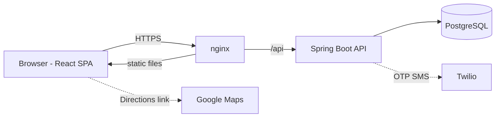

# MediSlot

Multi-hospital appointment, queue and patient management platform. Patients find nearby hospitals, book a doctor,
get Google Maps directions, check in with a QR code, wait in a live queue, and receive their prescription.

> **College project.** Use only synthetic (fictional) data. Real patient data needs a legal and security review first.

## Features

- **Patients:** register, find hospitals by location/radius or name, find doctors, book with a 5-minute slot hold,
  cancel/reschedule, QR code, live queue status, prescriptions (PDF), follow-ups, notifications.
- **Doctors:** working hours, leave, today's queue, consultation notes, prescriptions, follow-up dates.
- **Receptionists:** QR check-in, queue board, walk-ins, appointment list, no-show handling.
- **Hospital admins:** departments, doctors, receptionists, holidays, hospital profile and map location, dashboards, reports (CSV).
- **Super admin:** hospitals and their administrators, audit log.

### Smart nearby search and Google Maps directions

1. The patient shares their location (or searches an area) and picks a radius (1-50 km, default from `DEFAULT_HOSPITAL_SEARCH_RADIUS_KM`).
2. `GET /api/hospitals/nearby` filters and sorts by distance **in PostgreSQL** (Haversine with a bounding-box prefilter).
3. After booking, **Get Directions in Google Maps** opens
   `https://www.google.com/maps/dir/?api=1&destination=<lat>,<lng>&travelmode=driving`.
   The coordinates come from the database. Nothing about the patient goes in the URL, and Google finds the patient's position itself.
   No paid Maps API is needed.

## Architecture



Backend layers: Controller, Service, Repository, Database. DTOs only (entities are never exposed), global exception handling,
stateless JWT security, Flyway migrations.

Key design points: the database enforces "one booking per doctor and start time" (partial unique index), so two people can never
book the same slot; all status changes go through one state machine; notifications are sent after the transaction commits;
clinical data is visible only to the treating doctor and the patient.

## Requirements

Java 21, Maven 3.9+, Node 20+, PostgreSQL 16. Docker is optional.

## Run locally (no Docker)

1. **Database** (psql as the `postgres` user):
```sql
   CREATE USER medislot WITH PASSWORD 'choose-a-password';
   CREATE DATABASE medislot OWNER medislot;
```
2. **Backend:**
```powershell
   cd medislot-backend
   copy .env.example .env      # then edit .env: DB_PASSWORD and JWT_SECRET
   mvn spring-boot:run
```
   Generate a secret:
```powershell
   $b = New-Object byte[] 48; [Security.Cryptography.RandomNumberGenerator]::Create().GetBytes($b)
   ($b | ForEach-Object { $_.ToString("x2") }) -join ""
```
   Flyway creates the tables on first start. If `SERVER_PORT` is not 8080, set the same port in the frontend `.env`.
3. **Frontend:**
```powershell
   cd medislot-frontend
   "VITE_API_BASE_URL=http://localhost:8080/api" | Set-Content -Encoding ascii .env
   npm install
   npm run dev
```
   Open http://localhost:5173.

## Run with Docker

```powershell
copy .env.example .env      # fill DB_PASSWORD, JWT_SECRET, and the OTP / admin settings
docker compose up --build
```

Open http://localhost:8088 (or `HTTP_PORT`). Only the frontend port is published; the database and backend are internal.

- **Demo instance with demo accounts:** set `APP_PROFILE=demo` (and `REQUIRE_VERIFICATION=false`). Never use `demo` for real users.
- **Production:** keep `APP_PROFILE=prod`, set `BOOTSTRAP_SUPERADMIN_EMAIL` / `_PASSWORD` for the first start, log in at `/login`
  (you land on `/super-admin`), then remove those two variables and restart.
- **Docker Desktop will not start?** It needs virtualization enabled in BIOS and WSL 2. Everything above also works without Docker.

## Environment variables

| Variable | Meaning | Default |
|---|---|---|
| `DB_URL`, `DB_USERNAME`, `DB_PASSWORD` | PostgreSQL connection | local URL / `medislot` / required |
| `JWT_SECRET` | Token signing key, 32+ characters | required |
| `CORS_ALLOWED_ORIGINS` | Browser origins allowed to call the API | `http://localhost:5173` |
| `DEFAULT_HOSPITAL_SEARCH_RADIUS_KM` | Default search radius | 3 |
| `MAX_ACTIVE_APPOINTMENTS` | Active bookings per patient | 3 |
| `HOLD_MINUTES`, `CANCELLATION_CUTOFF_HOURS`, `MAX_RESCHEDULES` | Booking rules | 5 / 2 / 2 |
| `BOOKING_WINDOW_DAYS`, `CHECKIN_EARLY_MINUTES` | How far ahead / how early to check in | 30 / 60 |
| `REQUIRE_VERIFICATION` | OTP required at registration | true |
| `SMS_PROVIDER`, `TWILIO_*`, `SMS_DEFAULT_COUNTRY_CODE` | Twilio SMS | off / `+91` |
| `RATE_LIMIT_ENABLED`, `RATE_LIMIT_LOGIN_PER_MIN` | Per-IP limits | true / 10 |
| `REMINDERS_ENABLED`, `REMINDER_INTERVAL_MS` | Reminder job | true / 300000 |
| `APP_TIMEZONE` | Clinic timezone | `Asia/Kolkata` |
| `DEMO_DATA_ENABLED` | Seed demo accounts (non-prod only) | true |
| `BOOTSTRAP_SUPERADMIN_EMAIL`, `_PASSWORD` | Create the first platform admin | unset |

Never commit `.env`.

## Tests

```powershell
cd medislot-backend;  mvn clean test                          # unit and web-layer tests
mvn "-Dtest=SlotConcurrencyIT" test                           # 10 threads, one winner (uses your dev database)
mvn "-Dtest=BookingRulesIT" test                              # expiry, duplicates, limits (uses your dev database)
cd ..\medislot-frontend;  npm test                            # Vitest + Testing Library
```

## Demo accounts (demo profile only, password `Demo@1234`)

| Role | Email |
|---|---|
| Patient | `patient@demo.com`, `newpatient@demo.com` |
| Doctor | `doctor@demo.com` (Dr. Ravi Kumar), `dr.arjun@demo.com`, `dr.meera@demo.com` and others |
| Receptionist | `reception@demo.com` |
| Hospital admin | `admin@demo.com` (MediCare Hospital) |
| Super admin | `super@demo.com` |

These are fictional accounts for demonstration. See `docs/DEMO.md` for walkthroughs.

## API

See `docs/API.md`. Every response uses `{ success, message, code, data, timestamp }`.

## Production checklist

- [ ] HTTPS in front of the app (geolocation and the camera need it).
- [ ] `APP_PROFILE=prod`, strong `DB_PASSWORD`, random `JWT_SECRET`, correct `CORS_ALLOWED_ORIGINS`.
- [ ] A real OTP path: Twilio (with DLT registration for India) or `REQUIRE_VERIFICATION=false` knowingly.
- [ ] Remove the demo hospitals created by migration `V2` (before real use):
      `DELETE FROM hospitals WHERE phone LIKE '+91400000000%';`
- [ ] Remove `BOOTSTRAP_SUPERADMIN_*` after the first login; change the initial passwords of staff you create.
- [ ] Database backups; Twilio spend limit; one backend instance (the rate limiter is in memory).
- [ ] Legal and privacy review for your country before using real patient data.

## Known limits

No password change/reset, no email provider (SMS only), a no-show cannot be undone, completed consultations cannot be amended,
PDFs support Latin text only, rate limits are per instance.