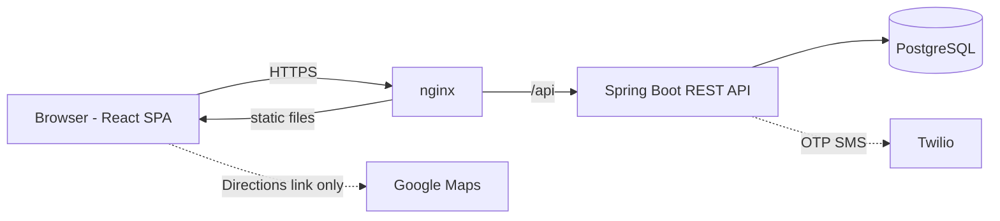
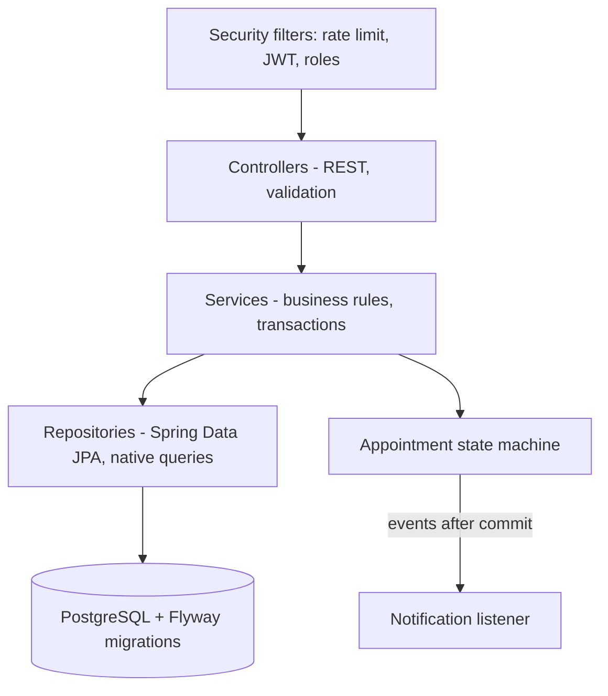
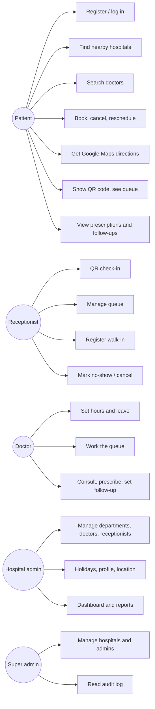
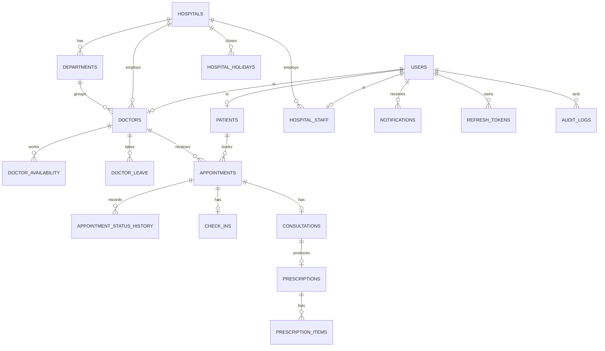
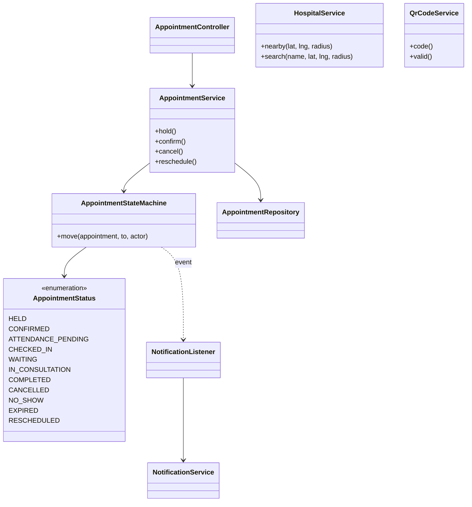
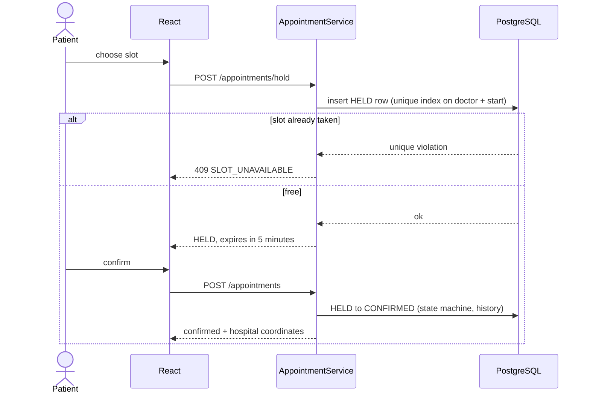
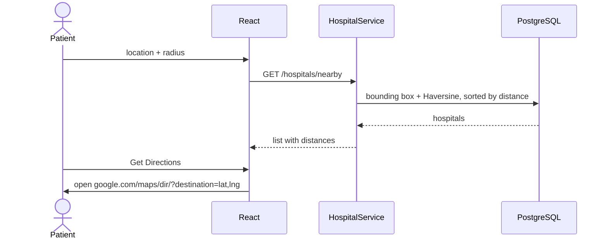
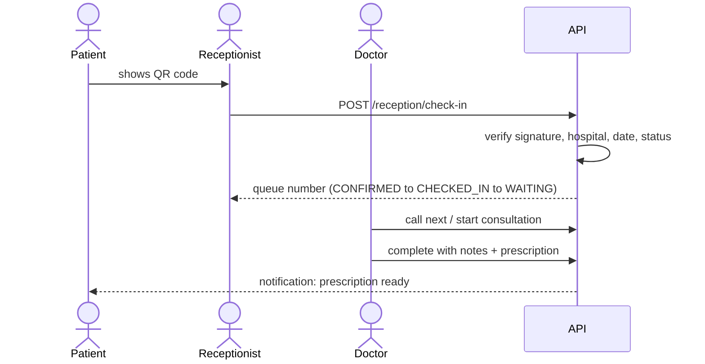
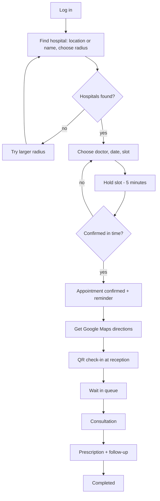

# MediSlot: Smart Multi-Hospital Appointment, Queue and Navigation Platform

*Project report. Student name: ________  Roll no.: ________  Guide: ________  Institution: ________  Year: ________*

---

## 1. Abstract

MediSlot is a web-based healthcare platform that lets patients find hospitals near them, book doctor appointments without
queuing in person, reach the hospital with Google Maps directions, check in with a QR code, and follow a live waiting queue.
Hospitals manage doctors, schedules, receptionists and reports; doctors run consultations and issue prescriptions.
The system is built with React, Spring Boot and PostgreSQL. Its main technical features are server-side nearby-hospital search
using the Haversine formula, a database-enforced guarantee that two patients can never book the same slot, an explicit appointment
state machine, role-based access control with JWT, and an audit trail. The project uses only synthetic data and is designed so
that it can later be hardened for real deployment.

## 2. Introduction

In many hospitals, patients travel to the hospital, take a token and wait for hours without knowing when they will be seen.
Appointment systems exist, but many are limited to a single hospital, do not help the patient find a nearby hospital, and do not
manage the visit itself (arrival, queue, consultation, prescription). MediSlot treats the whole journey as one connected flow:
find a hospital, book, travel, check in, wait, consult, receive the prescription, and follow up.

## 3. Problem Statement

1. Patients cannot easily discover which hospitals are near them and which doctors are available.
2. Booking is often by phone or in person, and slots can be double-booked or blocked casually by people who do not attend.
3. Patients do not know their position in the queue, so waiting is long and uncertain.
4. Hospitals lack simple tools for schedules, leave, walk-ins, queue handling and reports.
5. Clinical data (notes, prescriptions) must be visible only to the people who need it.

## 4. Existing System

Typical existing practice: phone or walk-in booking, paper registers, a physical token queue, handwritten prescriptions, and
separate single-hospital booking websites. Limitations: no location-based discovery, no live queue visibility, manual
double-booking checks, no automatic reminders, no analytics, and weak access control over records.

## 5. Proposed System

MediSlot is a multi-hospital platform with five roles (patient, doctor, receptionist, hospital admin, super admin).

- **Smart nearby hospital search and Google Maps navigation** (core feature). The patient shares a location or searches an area, chooses a
  radius (1, 3, 5, 10, 25, 50 km; default 3, configurable), and sees hospitals sorted by distance. The server performs the distance
  calculation in PostgreSQL. After booking, **Get Directions** opens Google Maps with the hospital as the destination.
- **Concurrency-safe booking** with a five-minute slot hold, duplicate and overlap prevention, an active-appointment limit,
  cancellation and rescheduling rules, and attendance confirmation to discourage time-pass bookings.
- **QR check-in, live queue, walk-ins** for reception, and a **consultation workflow** with prescriptions (PDF) and follow-up dates.
- **Notifications and reminders**, dashboards and reports, and an audit log.

## 6. Objectives

1. Let patients find nearby hospitals by location, radius or name.
2. Make double-booking impossible and discourage abuse.
3. Provide Google Maps directions to the booked hospital without building a navigation engine.
4. Digitise check-in, queue management, consultation and prescriptions.
5. Protect clinical data with role-based access and an audit trail.
6. Give hospitals schedules, leave, holidays, staff management and reports.
7. Keep the architecture maintainable and ready for later commercial features.

## 7. Scope

**In scope:** the features above, running as a web application, with synthetic demonstration data.
**Out of scope (future work):** payments, telemedicine, mobile apps, insurance and EHR integration, WhatsApp notifications,
password reset, multi-branch hospitals, PostGIS-scale geospatial search. Use with real patient data would first need a legal and
security review for the target country.

## 8. Functional Requirements

| ID | Requirement |
|---|---|
| FR1 | Patients register, log in and (optionally) verify their mobile number by OTP. |
| FR2 | Search hospitals nearby (current location or typed area), by radius, and by name; results sorted by distance, calculated on the server. |
| FR3 | When no hospital is in the radius, offer larger radii and search again on one click. |
| FR4 | Search doctors by name, specialization, hospital, department and location. |
| FR5 | Show free slots generated from doctor hours, minus leave, holidays and booked or held slots. |
| FR6 | Hold a slot for 5 minutes, then confirm; expired holds free the slot automatically. |
| FR7 | Prevent duplicate and overlapping bookings and enforce a maximum number of active appointments. |
| FR8 | Cancel and reschedule within hospital rules; every status change is validated by a state machine. |
| FR9 | Show hospital location and open Google Maps directions using stored coordinates. |
| FR10 | Generate a QR code; receptionists check patients in by QR or manually. |
| FR11 | Maintain a per-doctor queue with queue numbers; show the patient their position. |
| FR12 | Register walk-in patients without creating slot conflicts. |
| FR13 | Doctors write notes, diagnosis, prescription items and a follow-up date, then complete and lock the consultation. |
| FR14 | Patients view and download prescriptions (PDF) and see follow-ups. |
| FR15 | In-app notifications and mock email/SMS for confirmation, cancellation, reschedule, reminders, leave, check-in, prescription. |
| FR16 | Hospital admins manage departments, doctors, receptionists, holidays, profile and location; view dashboards and reports. |
| FR17 | Super admin manages hospitals and hospital admins and can read the audit log. |
| FR18 | Important actions are written to an audit log. |

## 9. Non-functional Requirements

- **Security:** BCrypt password hashing, JWT with rotating refresh tokens, role-based URL and data rules, rate limiting, secure HTTP headers, no secrets in code.
- **Privacy:** QR codes and map links contain no personal or medical data; the patient's location is never stored; clinical data is visible only to the treating doctor and the patient.
- **Reliability:** database constraints and transactions guarantee booking correctness; notifications are sent after commit and never break a booking.
- **Performance:** distance filtering in the database with a bounding-box prefilter and indexes; paged lists.
- **Usability:** responsive interface, clear status badges, loading, empty and error states, accessible forms.
- **Maintainability:** layered architecture, DTOs, Flyway migrations, automated tests.

## 10. System Architecture

**Backend layers:** Controller, Service, Repository, Database. Controllers hold no business logic. DTOs are used for every request and
response; JPA entities are never exposed. A global exception handler returns a uniform error format and never a stack trace.

## 11. Use Case Diagram

## 12. ER Diagram

## 13. Class Diagram (main classes)

## 14. Sequence Diagrams

**Booking with a slot hold**

**Nearby search and directions**

**QR check-in and consultation**

## 15. Activity Diagram (patient journey)

## 16. Database Design

Flyway migrations V1 to V7 create the schema (Hibernate never alters the production schema).

| Table | Purpose and key constraints |
|---|---|
| users | email and mobile unique; role check; lockout counters |
| patients, doctors, hospital_staff | one row per user of that kind; foreign keys to hospital and department |
| hospitals | latitude -90..90 and longitude -180..180 (check constraints), index on coordinates and lower(name) |
| departments | unique (hospital, name) |
| doctor_availability, doctor_leave, hospital_holidays | weekly hours (end after start), one leave and one holiday per day |
| appointments | **unique index on (doctor, slot_start) for active statuses**; unique queue number per doctor and day |
| appointment_status_history | every status change with actor and time |
| check_ins | one per appointment; method QR, MANUAL or WALK_IN |
| consultations, prescriptions, prescription_items | one consultation per appointment, one prescription per consultation |
| notifications | unique (user, dedupe key) prevents duplicates |
| refresh_tokens, verification_codes, audit_logs | hashed tokens and codes; audit records |

## 17. API Design

REST over JSON with a uniform envelope `{ success, message, code, data, timestamp }`. Roles are enforced twice: by URL rules in the
security configuration and by ownership checks in services (another user's record returns 404). The full list is in `docs/API.md`.

## 18. Security

- Passwords hashed with BCrypt; accounts lock for 15 minutes after 5 failed logins.
- Short-lived JWT access tokens; refresh tokens are stored hashed, rotate on every use, and reuse revokes all sessions.
- Role-based access control; clinical data only for the treating doctor and the patient; admins limited to their own hospital.
- Per-IP rate limiting; Content-Security-Policy, X-Frame-Options, Referrer-Policy and HSTS headers.
- QR codes are `MS1.<id>.<HMAC signature>`; they contain no personal data and cannot be forged or edited.
- Audit log for logins, bookings, cancellations, check-ins, schedule and staff changes, report exports and downloads (IDs only, no clinical text).
- Secrets only in environment variables; `.env` is never committed.

## 19. Hospital Location and Navigation

Each hospital stores latitude and longitude (admins can edit them). The patient's position is used only for one search and is not stored.
Distance is computed in PostgreSQL with the Haversine formula after a bounding-box prefilter that uses the coordinate index:

`d = 2R * asin( sqrt( sin^2(dLat/2) + cos(lat1) * cos(lat2) * sin^2(dLng/2) ) )`, with R = 6371 km.

Directions use Google's URL format, built from the database coordinates only:

`https://www.google.com/maps/dir/?api=1&destination=<lat>,<lng>&travelmode=driving`

Google Maps determines the patient's current position and performs the navigation. No patient, appointment or medical data appears in
the URL, and no paid Maps API is required. Typed-area search uses OpenStreetMap Nominatim, called from the browser without the
login token.

## 20. Implementation

- **Frontend:** React, React Router, Axios with a token-refresh interceptor, Tailwind CSS, plain SVG charts, Vitest and Testing Library.
- **Backend:** Java 21, Spring Boot 3, Spring Security, Spring Data JPA, Bean Validation, Flyway, OpenPDF, ZXing.
- **Database:** PostgreSQL 16.
- **Booking correctness:** a partial unique index decides who wins a slot; row locks serialise one patient's requests and status changes; expired holds are treated as free immediately and cleaned up by a background job.
- **State machine:** one class validates every transition and publishes an event; a listener sends notifications after the transaction commits.
- **Packaging:** Docker images for backend (multi-stage, non-root) and frontend (nginx with an `/api` proxy), Docker Compose, GitHub Actions CI.

## 21. Testing

| Level | What is covered |
|---|---|
| Unit | slot generation, schedule rules, booking policy, status transitions, distance (Haversine) and radius rules, QR signing, check-in rules, queue order, reminder policy, report maths, rate limiter, phone formatting |
| Web layer | authentication and role access for every role group, security headers, error codes |
| Database (integration) | **concurrent booking: 10 threads, exactly one wins**; expired hold, duplicate booking, cancelled slot, active-appointment limit |
| Frontend | login, hospital search and radius, no-results prompt, Get Directions link contents, role-based navigation and route guards, booking flow, chart |
| Manual | PowerShell API scripts and browser walk-throughs for each phase |

Edge cases from the specification (same slot booked simultaneously, expired hold, doctor on leave, cancelled appointment, duplicate booking,
maximum active appointments, invalid JWT, invalid status transition, location permission denied, no hospitals in radius, invalid radius,
invalid coordinates) are each covered by an automated or manual test.

Commands: `mvn clean test`, `mvn "-Dtest=SlotConcurrencyIT" test`, `mvn "-Dtest=BookingRulesIT" test`, `npm test`.

## 22. Results

*Fill this section with your own evidence before submitting.*

| Item | Your result |
|---|---|
| Backend unit and web tests | ____ tests, ____ failures |
| Concurrency test (10 simultaneous holds on one slot) | ____ succeeded, ____ rejected |
| Booking rules integration test | ____ passed |
| Frontend tests | ____ tests, ____ failures |
| Nearby search, 1 km / 3 km / 10 km from one point | hospitals returned: ____ / ____ / ____ |
| Screenshots to include | search results, hospital page with Get Directions, booking confirmation, QR page, reception check-in, doctor queue, consultation, prescription PDF, admin dashboard and reports |

## 23. Future Enhancements

Online payments and refunds; telemedicine and video consultation; Android/iOS apps; WhatsApp and email notifications; password reset and
change-password; multi-branch hospitals; insurance and EHR integration; PostGIS and map-click location picking; queue-time prediction
using history; shared (Redis) rate limiting for multiple servers; amendments to completed consultations; Unicode fonts for regional-language PDFs.

## 24. Conclusion

MediSlot demonstrates a complete, secure appointment journey for multiple hospitals: location-aware discovery, slot booking that cannot
double-book, directions through Google Maps, QR check-in, a live queue, consultations with prescriptions, notifications, dashboards and
reports. The key design choices (database-enforced booking correctness, a single state machine, server-side distance search, privacy by
design in QR codes and map links, and role-based access with auditing) make it a sound base for a production system after the required
legal and security review.

## Appendix A. Demo accounts (demonstration data only, password `Demo@1234`)

patient@demo.com, doctor@demo.com, reception@demo.com, admin@demo.com, super@demo.com.

## Appendix B. How to produce the final document

- GitHub and VS Code (Markdown Preview Mermaid Support) render the diagrams. To get images, paste each diagram into https://mermaid.live and export PNG or SVG.
- To make a Word or PDF copy: install pandoc and run `pandoc docs\REPORT.md -o MediSlot-Report.docx`. Replace the Mermaid blocks with the exported images first, because pandoc does not draw them.